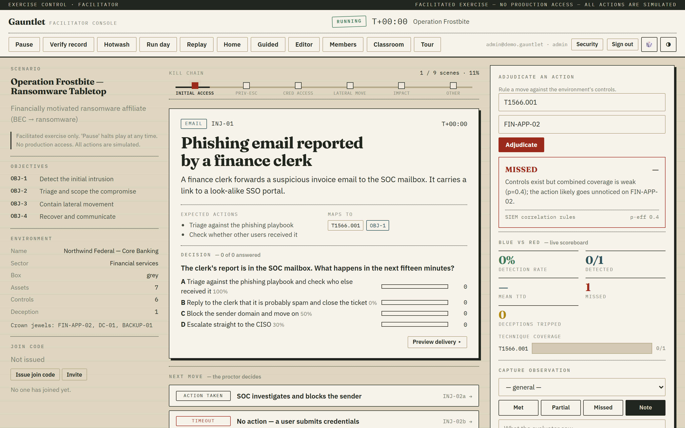
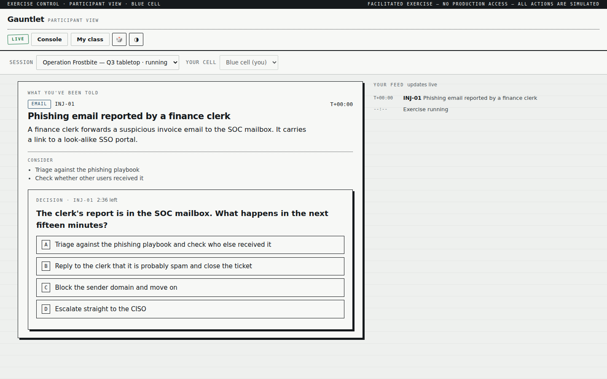
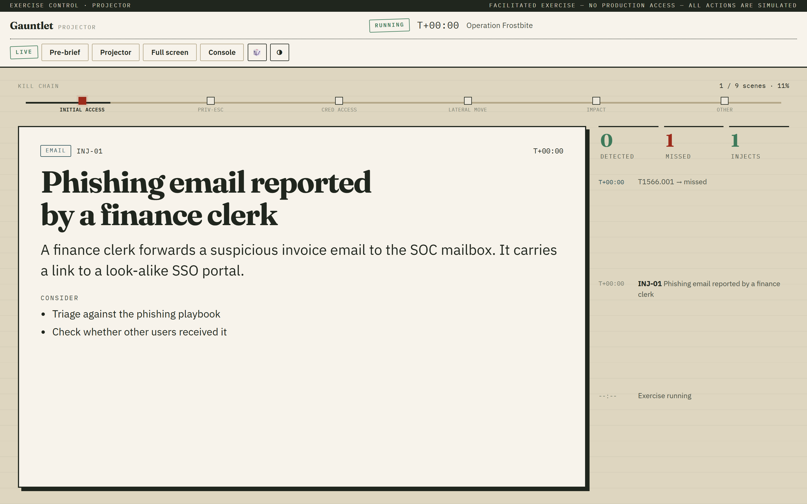
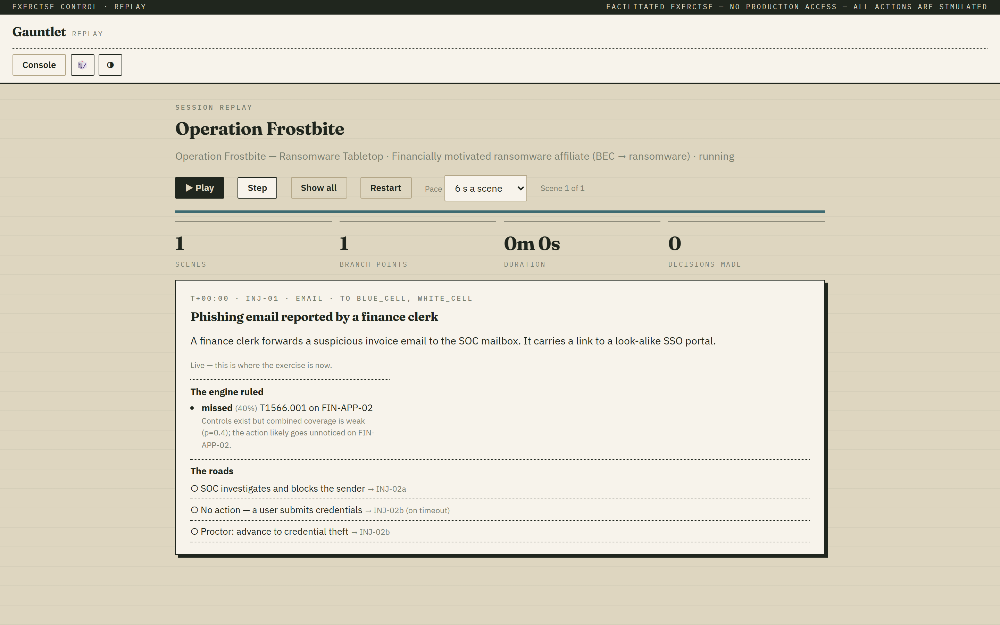
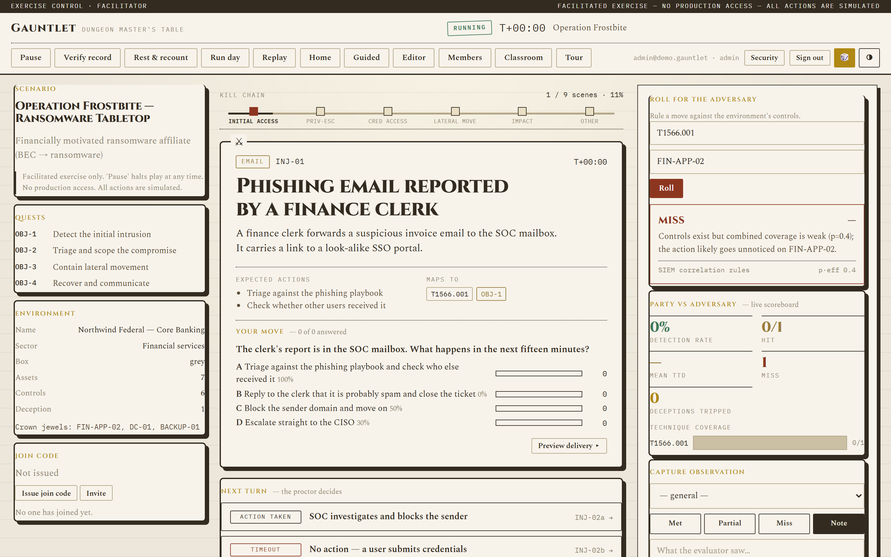
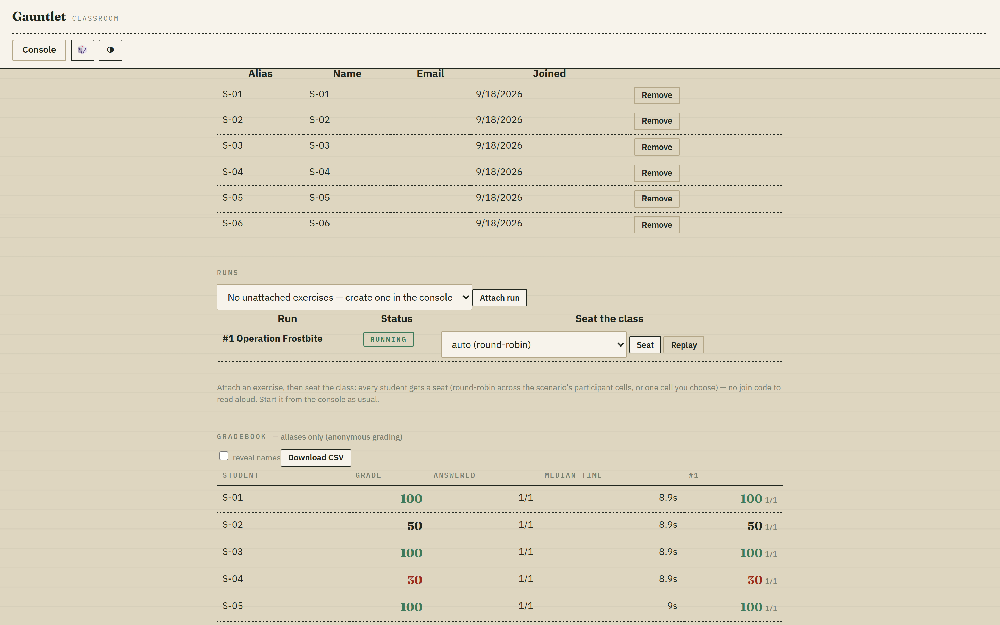

# Gauntlet

**Security exercises that produce a signed record.** Gauntlet runs tabletop and
purple-team exercises the way a good game master runs a table: it knows the
environment under test, presents each scene, lets the room decide, rules every
adversary move against the controls that are actually in place, and writes
all of it to a tamper-evident timeline. From that one record come the
reports, the compliance evidence, the improvement plan and a certificate
anyone can verify.

Self-hosted, one container, SQLite or Postgres, air-gap capable. The full
engine is free; paid tiers add what a programme, a classroom or an enterprise
needs around it.



## In pictures

| | |
|---|---|
| **Participants decide from their own device.** Every scene can carry a decision card; answers land on the record with score and latency, and the proctor sees the tally live.  | **The room sees the scene, not the console.** A projector view for run day, with the kill chain and the live tally; a pre-brief and a hotwash around it.  |
| **Replay any exercise scene by scene.** What the room answered, what the engine ruled, the branch taken and what it cost, and the roads not taken. Rewind forks a new run from any scene.  | **Game mode for students and enthusiasts.** The same engine as cards, a d20 that always agrees with the ruling, XP, hit points and quests. Free, one click.  |

**A classroom in one code.** Students enrol themselves, get seated in one
click, are graded anonymously by alias until the instructor reveals names, and
the gradebook exports to CSV.



## Quick start

```bash
cd backend
python -m venv .venv && . .venv/bin/activate
pip install -r requirements.txt
python -m uvicorn app.main:app --reload --port 8000
```

Open <http://localhost:8000/> and sign in as **`admin@demo.gauntlet` /
`gauntlet-admin`** (override with `GAUNTLET_DEMO_PASSWORD`). A finance-sector
ransomware tabletop, *Operation Frostbite*, is seeded so the whole loop works
in the first minute: press **Tour** for a guided walk, or **Guided** to build
and run your own. The OpenAPI docs are at `/docs`.

For a real deployment:

```bash
cp .env.example .env            # set GAUNTLET_SECRET_KEY and POSTGRES_PASSWORD
docker compose up -d --build    # app + Postgres, migrations run on start
```

One process, one worker per container, TLS at your proxy. The production
checklist, the air-gapped procedure and scaling notes are in
[`docs/DEPLOY.md`](docs/DEPLOY.md); releases are tagged, published to GHCR
with an SBOM, and described in [`CHANGELOG.md`](CHANGELOG.md).

## How an exercise runs

1. **Model the environment.** Assets, controls with efficacy and latency,
   detections, playbooks, policies, personnel, deception assets, crown jewels,
   with white / grey / black-box visibility per cell. Stamp one of six library
   environments, or import a CMDB, EDR, SIEM or attack-surface export.
2. **Build the exercise.** Emulate a real ATT&CK group or a designed adversary
   through a template, import a CISA CTEP pack (eleven ship in the box), paste
   YAML, or draw the branching scenario in the visual editor. Every scene can
   carry a decision card, delivery channels and an impact estimate.
3. **Run the room.** Join codes for large groups; blue, red, executive and
   observer cells each see only their side; injects can be delivered as the
   email, chat message or alert they pretend to be. The facilitator drives from
   the keyboard; the projector view faces the room.
4. **Adjudicate.** Each adversary move is ruled deterministically against the
   environment: detected or missed, how fast, by which control, with the
   rationale. The red cell learns instantly whether it was caught. Real SIEM
   and EDR alerts can be recorded against the expected ones.
5. **Hotwash and record.** Rate every objective before anyone leaves, log
   improvement items and push them to Jira or ServiceNow, issue the signed
   certificate. Four reports (executive, technical, GRC evidence across eleven
   frameworks, training gaps), a board pack, an ATT&CK Navigator layer and the
   raw timeline all come from the same chain.

## What is in the box

| Area | What you get | Read more |
|---|---|---|
| Engine | Branching MSEL with state-driven guards, deterministic adjudication, hash-chained and signed timeline, real-time WebSocket updates, auto-advance timers | [`docs/DESIGN.md`](docs/DESIGN.md) |
| Authoring | Adversary catalog (real ATT&CK groups and designed adversaries), scenario templates and inject bank, CTEP importer, YAML import/export, visual editor, guard-railed LLM assist (optional, deterministic by default) | [`docs/API_TOUR.md`](docs/API_TOUR.md) |
| The room | Participant decisions, executive track with impact and communications decisions, inject delivery by email / Slack / Teams, evidence attachments hashed into the chain, propose-next-scene, run-day mode | [`docs/UX_DESIGN.md`](docs/UX_DESIGN.md) |
| Outcomes | Exercise and attendance certificates with public verification, executive / technical / GRC / training reports, DOCX and branded PDF exports, compliance crosswalks, Navigator layers, improvement plan with tracker sync, programme analytics and sector benchmark | [`docs/API_TOUR.md`](docs/API_TOUR.md) |
| Purple team | Red-cell play view, live blue-vs-red scoreboard, telemetry loop against real alerts, authorisation-gated range adapters (simulation, Caldera, Atomic) | [`docs/API_TOUR.md`](docs/API_TOUR.md) |
| Education | Cohorts, self-enrolment by code, one-click seating, anonymous grading, gradebook and CSV export, session replay and rewind, game mode | [`docs/LICENSING.md`](docs/LICENSING.md) |
| Content | Signed scenario packs and an adversary intel feed, installed offline from the Members page; a publisher tool | [`docs/CONTENT_PACKS.md`](docs/CONTENT_PACKS.md) |
| Identity and tenancy | Organisations with roles, a participant boundary enforced on the server, OIDC SSO, SCIM 2.0, TOTP MFA, rotating refresh tokens, white-label branding, partner mode for consultancies | [`docs/ENTERPRISE.md`](docs/ENTERPRISE.md) |
| Data protection | Encryption at rest with a rotatable keyring, Postgres row-level security on in production, retention and erasure, GDPR export, audit log, air-gapped mode | [`docs/THREAT_MODEL.md`](docs/THREAT_MODEL.md), [`SECURITY.md`](SECURITY.md) |
| Licensing | Offline Ed25519 licences by tier with facilitator seats, key ids and rotation, serials and signed revocation, a grace period that degrades and never hides | [`docs/LICENSING.md`](docs/LICENSING.md), [`docs/KEY_MANAGEMENT.md`](docs/KEY_MANAGEMENT.md) |

## Tiers

| Tier | For | Adds |
|---|---|---|
| **Community** (free) | Anyone self-hosting | The full engine, the record, reports, certificates, exports, libraries, game mode, one organisation |
| **Team** | A security team running a programme | Facilitator seats, telemetry loop, tracker push, white-label branding, scenario content packs |
| **Education** | A course, a lab or a cyber club | Team, plus cohorts, anonymous grading, the gradebook, session replay and rewind |
| **Enterprise** | Regulated, multi-team or air-gapped | Education, plus SSO and SCIM, partner mode, the intel feed, sector benchmarking, support |

Details and the packaging page: [`docs/LICENSING.md`](docs/LICENSING.md) and
`/product.html` on a running instance.

## Configuration

| Variable | Default | Purpose |
|---|---|---|
| `GAUNTLET_DB_URL` | `sqlite:///…/gauntlet.db` | Database URL (SQLite or Postgres) |
| `GAUNTLET_SEED` | `1` | Load the worked example on an empty database |
| `GAUNTLET_ACCESS_TTL_MIN` | `30` | Access-token lifetime (minutes) |
| `GAUNTLET_REFRESH_TTL_DAYS` | `30` | Refresh-token lifetime (days) |
| `GAUNTLET_PASSWORD_MIN_LEN` | `10` | Minimum password length |
| `GAUNTLET_WS_TICKET_TTL_SEC` | `30` | WebSocket connection-ticket lifetime (seconds) |
| `GAUNTLET_MFA_ISSUER` | `Gauntlet` | Issuer label shown in authenticator apps |
| `GAUNTLET_OIDC_ISSUER` / `_CLIENT_ID` / `_CLIENT_SECRET` / `_REDIRECT_URI` | — | OIDC SSO (enabled when issuer + client id are set) |
| `GAUNTLET_ENCRYPT_AT_REST` | `0` | Encrypt sensitive environment fields at rest (derives a data key from the master) |
| `GAUNTLET_DATA_KEYS` | — | Explicit rotatable data keyring, `v2:<b64>,v1:<b64>` (primary first) |
| `GAUNTLET_RETENTION_DAYS` | `0` | Retention window for completed sessions + audit log (0 = off) |
| `GAUNTLET_RLS_ENABLED` | `0` | Enable Postgres row-level security (no-op on SQLite) |
| `GAUNTLET_BRAND_NAME` | `Gauntlet` | Brand name in exported PDF header/footer |
| `GAUNTLET_BRAND_ACCENT` | `37,99,235` | PDF accent colour, `R,G,B` |
| `GAUNTLET_NOTIFY_WEBHOOK` | — | Optional URL that scheduled reminders are POSTed to |
| `GAUNTLET_JIRA_URL` / `_USER` / `_TOKEN` / `_PROJECT` | — | Jira tracker for improvement-item push/sync |
| `GAUNTLET_SERVICENOW_URL` / `_USER` / `_PASSWORD` | — | ServiceNow tracker for improvement-item push/sync |
| `GAUNTLET_RANGE_ADAPTER` | `simulation` | Live-inject range: `simulation` / `caldera` / `atomic` |
| `GAUNTLET_RANGE_ALLOWLIST` | — | Comma-separated hosts a real range may target (empty = block all) |
| `GAUNTLET_CALDERA_URL` / `_API_KEY` | — | MITRE Caldera endpoint for live injects |
| `GAUNTLET_ATOMIC_URL` / `_TOKEN` | — | Atomic Red Team runner endpoint for live injects |
| `GAUNTLET_LLM_PROVIDER` / `_API_KEY` / `_MODEL` / `_BASE_URL` | — | Opt-in LLM for authoring assist (else a deterministic template) |

---
| `GAUNTLET_ENV` | `dev` | `prod` turns on the production checks: pinned signing keys, RLS, no docs, strict config |
| `GAUNTLET_LICENSE` | — | Licence token (or install it on the Members page) |
| `GAUNTLET_LICENSE_REVOCATIONS` | — | Signed revocation list (or install it on the Members page) |
| `GAUNTLET_LICENSE_PUBKEYS` / `GAUNTLET_PACK_PUBKEYS` | — | Extra trusted signing keys, `kid=base64url,...`; outside production, or with `GAUNTLET_TRUST_ENV_KEYS=1` |
| `GAUNTLET_AIRGAPPED` | `0` | Fail closed on every outbound connection and show the badge |
| `GAUNTLET_REDIS_URL` | — | Shared store for throttles when running more than one container |

## Test

```bash
cd backend && . .venv/bin/activate
python -m pytest -q                 # engine, API, tenancy, licensing
python -m pytest -q tests/e2e       # headless-Chromium walk of the console
```

CI runs the suite, the browser smoke, `alembic upgrade head` and
`alembic check` on a fresh database, JavaScript syntax, SAST, dependency
audit, secret scanning and an SBOM on every pull request.

## Layout

```
backend/app/            FastAPI app, ORM model, engine (msel, adjudication, reporting), api/
backend/migrations/     Alembic migrations (the schema authority in deployments)
backend/tests/          unit, API, tenancy, licensing and e2e tests
web/                    the console and companion pages (vanilla JS, no build step)
tools/                  vendor tools: issue_license.py, build_pack.py
docs/                   design, deployment, enterprise, threat model, licensing, key management, API tour
```

## Documentation

- [`docs/DESIGN.md`](docs/DESIGN.md) — the design brief (also `docs/design.html`)
- [`docs/DEPLOY.md`](docs/DEPLOY.md) — production checklist, air-gapped procedure, scaling
- [`docs/ENTERPRISE.md`](docs/ENTERPRISE.md) — SSO, SCIM, RLS, Redis, SBOM, pen-test readiness
- [`docs/THREAT_MODEL.md`](docs/THREAT_MODEL.md) and [`SECURITY.md`](SECURITY.md) — what is defended, how to report
- [`docs/LICENSING.md`](docs/LICENSING.md), [`docs/KEY_MANAGEMENT.md`](docs/KEY_MANAGEMENT.md), [`docs/CONTENT_PACKS.md`](docs/CONTENT_PACKS.md) — the paid surface and how it is signed
- [`docs/API_TOUR.md`](docs/API_TOUR.md) — per-feature API walkthroughs
- [`docs/POSITIONING.md`](docs/POSITIONING.md) — who it is for and against what

## Contact

Gauntlet is made by [Moose Arsenal](https://moosearsenal.com). Sales:
sales@moosearsenal.com. Support: support@moosearsenal.com. Security reports:
security@moosearsenal.com (see [`SECURITY.md`](SECURITY.md)).

## Responsible use

Gauntlet is for designing and running **defensive** exercises against an
environment you own or are explicitly authorised to test. Adversary techniques
are modelled only to build the exercise, never as operational guidance against
systems you do not control. Modes that could touch a real range stay gated
behind explicit rules of engagement and an allow-list, and the air-gapped mode
makes no outbound connection at all.
